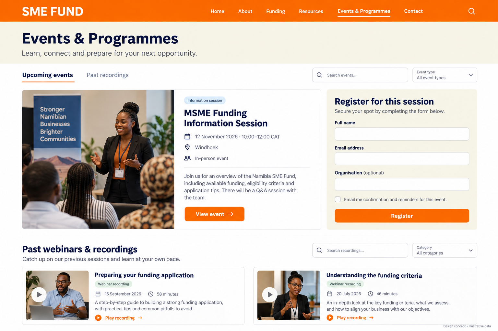
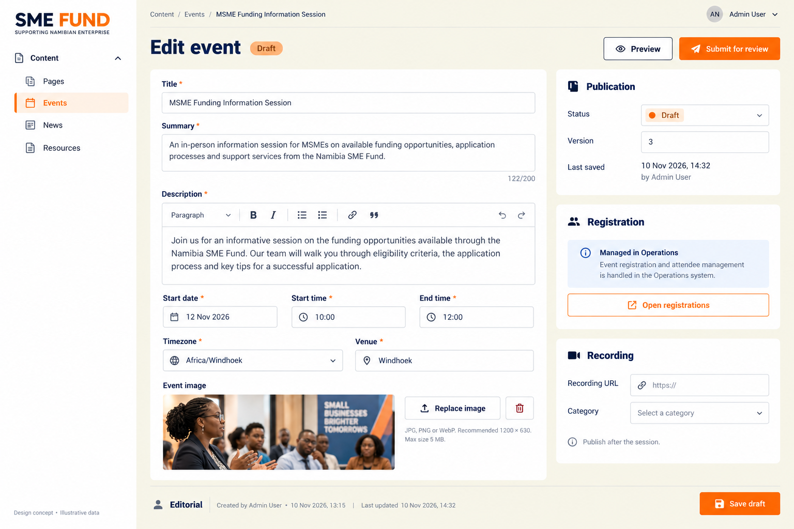
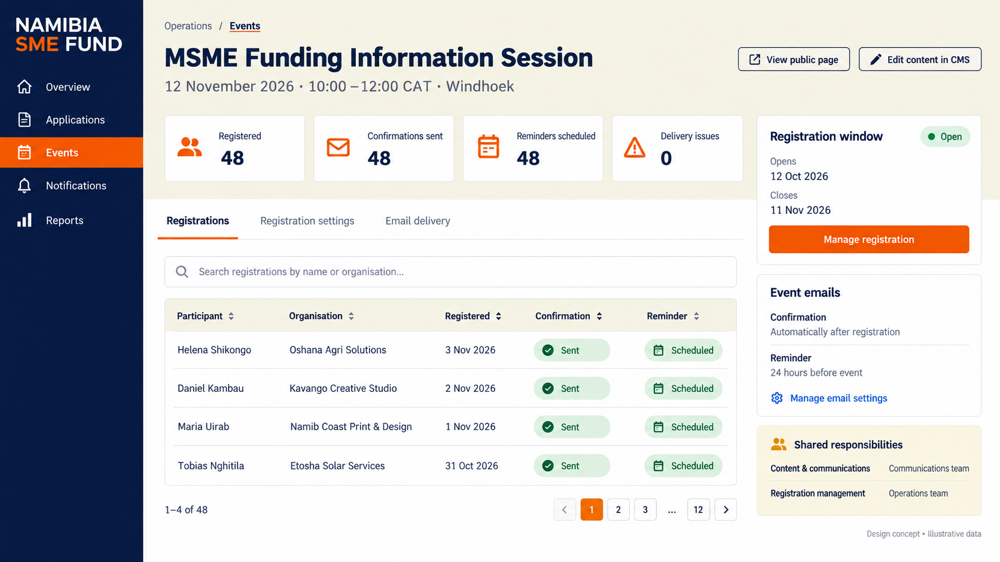

# Events & Programmes Implementation Plan

Status: implementation plan; implementation and acceptance remain pending.

## 1. Scope and source of requirements

Implement the three UI concepts referenced below: the public Events & Programmes
screen, the CMS event editor, and the Operations registration screen. These images
define the intended screen composition, hierarchy, labels, and controls.

The client requirements come from [Terms of Reference -2.pdf](<client/Terms of Reference -2.pdf>):

| Source | Requirement |
| --- | --- |
| Page 6, Events Calendar | Upcoming information sessions, workshops, and roadshows. |
| Page 8, Events and Information Sessions | Integrated calendar covering roadshows, applicant information sessions, and stakeholder forums; online registration; automated confirmation and reminder emails; searchable, filterable past webinar and virtual-session content. |
| Page 12, functional requirements | Event listing and registration functionality. |
| Page 6, Content Management System | Independent staff content editing/publication, controlled access, audit trail, and version history. |

The [Website Information Request](<source-material/Website Information Request_.docx>)
records that downloadable resources, including webinar recordings, were not
available at that time. Production content must be supplied; mockup content is
illustrative.

For this feature, this plan replaces the narrower scope in Phase 7 of
[the public website CMS plan](SME_Fund_Public_Website_CMS_Implementation_Plan.md#phase-7--events--programmes-page).
That earlier section does not cover the complete registration, email, and recording requirements.

## 2. Exact UI references

Use the saved PNGs themselves as the visual references. The generation prompts
are provenance, not additional requirements. Implement the layouts using existing
application components and approved brand assets; do not render the PNGs as pages.
Sample people, dates, counts, photographs, and the design-concept footer are not
production content. Preserve the established application navigation and branding.

### UI-01 — Public Events & Programmes

File: [public-events-concept.png](design/events-programmes/public-events-concept.png)

Implement the screen as shown:

- Orange public header and cream introduction headed **Events & Programmes**.
- **Upcoming events** and **Past recordings** navigation, event search, and event-type filter.
- Event presentation with image, category, title, date/time, venue, summary, and **View event**.
- Adjacent **Register for this session** panel with **Full name**, **Email address**,
  **Organisation (optional)**, the displayed email checkbox, and **Register**.
- **Past webinars & recordings** section with search, category filter, recording
  cards, and **Play recording** links.

The registration panel must clearly refer to the event being displayed/selected.
Use `/events` for this public screen and preserve `/events/[slug]` for the existing
event detail destination. Keep the detail page consistent with UI-01; no separate
detail-page redesign is specified. The dated event listing is the calendar
presentation in this scope; do not add an unpictured month/week calendar interface.

### UI-02 — CMS event editor

File: [cms-event-editor-concept.png](design/events-programmes/cms-event-editor-concept.png)

Implement the screen as shown within the embedded Payload CMS:

- **Content / Events** navigation, event breadcrumb, **Edit event**, and publication status.
- **Preview**, **Submit for review**, and **Save draft**, respecting existing permissions.
- Main form: **Title**, **Summary**, **Description**, **Start date**, **Start time**,
  **End time**, **Timezone**, **Venue**, and **Event image**.
- **Publication** panel with status, version, and last-save information.
- **Registration** panel with **Managed in Operations** and **Open registrations**.
- **Recording** panel with **Recording URL**, **Category**, and the after-session guidance.

**Open registrations** navigates to the linked Operations event; it is not an
action that changes registration availability. Retain existing CMS metadata and
publishing protections. Reuse existing field facilities for the category/type
metadata required by the public filters; do not invent another management screen.

### UI-03 — Operations registrations

File: [operations-registrations-concept.png](design/events-programmes/operations-registrations-concept.png)

Implement the screen as shown:

- Operations **Events** navigation, event title, date/time, and venue.
- **View public page** and **Edit content in CMS** links.
- Summary cards: **Registered**, **Confirmations sent**, **Reminders scheduled**,
  and **Delivery issues**.
- Tabs: **Registrations**, **Registration settings**, and **Email delivery**.
- Searchable, paginated registration table with **Participant**, **Organisation**,
  **Registered**, **Confirmation**, and **Reminder** columns.
- **Registration window** panel with availability, opening/closing dates, and
  **Manage registration**.
- **Event emails** panel showing confirmation after registration and the displayed
  reminder timing, with **Manage email settings**.
- The informational **Shared responsibilities** panel shown in the image.

Settings and email-delivery tabs are destinations for the controls already shown:
registration opening/closing, confirmation/reminder configuration, and delivery
status. Compose them with existing forms and tables. No additional dashboard,
charts, attendee workflow, or bespoke email designer is included.

## 3. Ownership and existing implementation

| Responsibility | Owner |
| --- | --- |
| Event copy, image, date/time, venue, categories, publication, and recordings | CMS |
| Registration window, participants, and event email configuration | Operations |
| Discover events, register, and access recordings | Public website |
| Confirmation/reminder dispatch, retries, and delivery status | Existing notification engine |

Keep a stable link between the CMS event and its operational records. Operations
reads the event identity and published details; staff must not enter duplicate
titles, dates, venues, or descriptions there. Draft edits remain inactive until
publication. Participant data must never appear in public content projections.

Existing code to extend:

- [Events collection](../apps/platform/src/payload/collections/content/Events.ts):
  event content, dates, image, external registration URL, drafts, access, audit,
  preview, and publication hooks.
- [Public listing](../apps/platform/src/app/(public)/events/page.tsx) and
  [detail page](../apps/platform/src/app/(public)/events/[slug]/page.tsx).
- [Content queries](../apps/platform/src/modules/content/ServerContentQueries.ts):
  existing event read models and detail lookup.
- [Notification module](../apps/platform/src/modules/notifications): existing
  occurrence, dispatch, template, retry, and delivery infrastructure.

The current registration URL is not evidence of an implemented registration flow.
Introduce the depicted application form without silently rewriting existing URLs
or treating an external link as equivalent to the required email integration.

## 4. Delivery phases

Each phase requires focused evidence before proceeding to acceptance. The images
remain the visual reference throughout; phases do not authorize additional UI.

### Phase 1 — Data and service foundation

- Extend existing event/content infrastructure and introduce application-owned
  registration settings and participant persistence, linked to the stable event ID.
- Add repeatable migrations and contextual permissions in the canonical catalogue.
- Implement server-side registration-window and publication checks, validation,
  duplicate-submission protection, and atomic registration/audit/notification intent.
- Keep search, filtering, ordering, counts, and pagination in the persistence layer.
- Resolve event detail directly by slug rather than through a bounded listing.

Acceptance: focused repository/service tests cover linkage, projections, duplicate
submissions, date boundaries, authorization, and published-only public access.

### Phase 2 — CMS editor (UI-02)

- Compose the editor around the UI-02 form and side panels.
- Extend recording and category metadata required by UI-01.
- Link the event to its Operations destination and preserve review, versions,
  preview, audit, and publication behaviour.

Acceptance: staff can save, preview, submit for review, and publish an event;
draft changes do not change public content or active registration/email behaviour.

### Phase 3 — Public events and registration (UI-01)

- Implement the pictured event layout, search/filter controls, and registration form.
- Display date/time consistently in the event timezone.
- Show accessible validation, submission progress, and confirmation using existing
  components. Prevent duplicate registration on retries and repeated clicks.
- Keep existing detail navigation working for events beyond the first listing page.

Acceptance: a visitor can find the intended event and register; invalid, closed,
or unpublished event registrations are rejected by the server.

### Phase 4 — Operations and automated emails (UI-03)

- Implement the pictured summary cards, tabs, participant table, settings panels,
  and links to CMS/public content.
- Connect confirmation and reminder notifications to the existing engine and
  templates; derive displayed counts/statuses from persisted records.
- Implement the pictured 24-hour reminder setting as the initial UI configuration.
- Ensure retries do not create duplicate notification intent. Published date
  changes must reconcile pending reminders; withdrawn events must not send stale reminders.

Acceptance: staff permissions are enforced server-side; registration produces the
intended confirmation, scheduled reminders use the event time, and delivery states
match the table/cards. Verify real email receipt separately from automated tests.

### Phase 5 — Recording archive and visual acceptance (UI-01–03)

- Complete published recording search, category filtering, and playback links.
- Compare all three implemented screens against their exact PNG references.
- Adapt the same hierarchy for small screens with existing responsive patterns.
- Verify keyboard access, form labels/errors, and readable table behaviour.

Acceptance: published recordings can be found and opened; desktop/mobile evidence,
automated checks, and written acceptance are recorded. Supplied production media
is a content dependency, not permission to fabricate events or recordings.

## 5. Repository implementation constraints

Follow the [structure contract](SME_Fund_Project_Structure_Contract_FINAL.md) and
repository rules. Keep editorial work in the existing content/Payload ownership,
notification work in the notification module, and operational code under its
owning feature using the documented module convention. Migrate touched legacy
UI to the prescribed ownership; reuse shared primitives rather than copying them.

Application forms use React Hook Form and Zod through `zodResolver`. Interactive
server state follows hook → client service → API → backend service → repository.
Payload internal forms retain their native mechanisms. Application records remain
in PostgreSQL; Firebase remains the authentication owner. Staff operations require
canonical permissions plus applicable resource-context checks.

At implementation completion, run architecture/file-size gates, lint, type checking,
and appropriate tests. Record browser, database, and actual email-delivery evidence
separately. Do not run a production build or deploy without explicit instruction.

## 6. Scope discipline

The registration fields are the fields in UI-01. Do not introduce a required
applicant account, extra participant questions, capacity/waitlists, ticketing,
payments, attendance/check-in, certificates, exports, or a separate programme
management system under this plan.

The email checkbox is event-specific; it must not subscribe visitors to marketing.
Its unchecked-state behaviour needs to be resolved against the required automatic
confirmation/reminder flow before implementing that submission rule. This is a
behaviour clarification, not an additional screen or feature.

The 24-hour timing comes from UI-03, not from an explicit timing rule in the client
Terms of Reference. Sample counts and dates are replaced with actual persisted data.
Do not expand this plan from incidental generated text or invented mockup branding.
